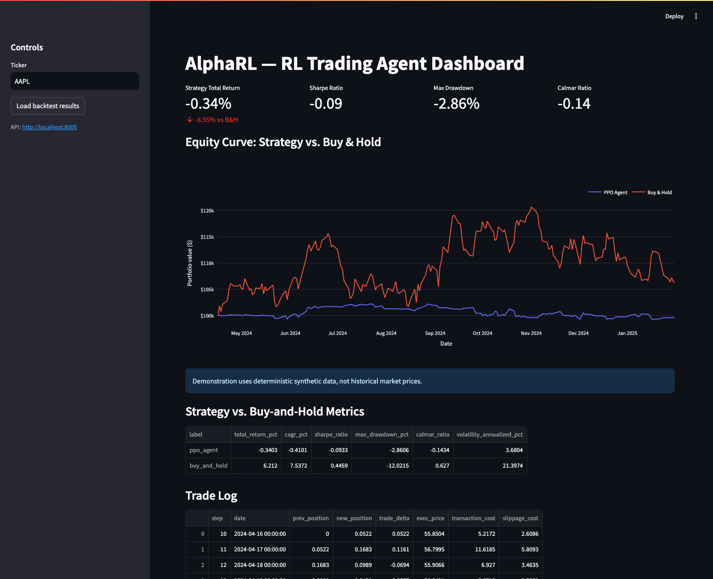
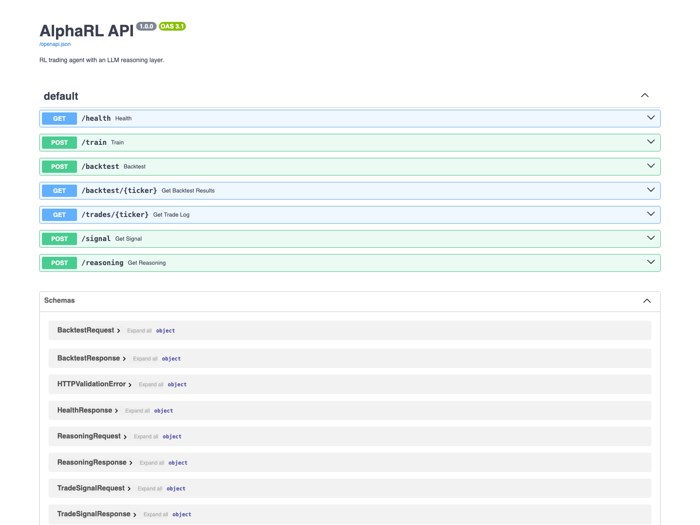

# AlphaRL

A reinforcement-learning trading agent with an LLM reasoning layer. AlphaRL trains a PPO agent (Stable-Baselines3) to size positions in a single equity using price action, technical indicators, news sentiment (FinBERT), and macro context (VIX, yield curve), then explains every trade it makes in plain English via a local LLM.

**Runs entirely free.** Market data (yfinance), macro data (FRED free tier), sentiment scoring (FinBERT, runs locally), and trade reasoning (Ollama, runs locally) require no paid API. A hosted-Claude reasoning option exists but is off by default.

> **Research demo only.** This project does not place trades or provide investment advice. The
> offline demo uses synthetic prices and must not be interpreted as historical performance.

## Dashboard preview

Run AlphaRL locally using the offline demo instructions below, then open
`http://localhost:8501`. Screenshots are in [`screenshots/`](screenshots/).





---

## Architecture

```
                     ┌───────────────────────────────────────────────┐
                     │                DATA PIPELINE                  │
                     │  yfinance (OHLCV)  FRED (VIX/yields)          │
                     │  NewsAPI + FinBERT (sentiment)                │
                     └──────────────────────┬────────────────────────┘
                                            │  unified_dataset.csv
                                            ▼
                     ┌───────────────────────────────────────────────┐
                     │             FEATURE ENGINEERING                │
                     │  RSI, MACD, Bollinger, SMA/EMA (no lookahead) │
                     │  chronological train/val/test split           │
                     │  normalization fit on train split only         │
                     └──────────────────────┬────────────────────────┘
                                            │
                                            ▼
                     ┌───────────────────────────────────────────────┐
                     │         CUSTOM GYMNASIUM TRADING ENV           │
                     │  continuous position sizing [-1, 1]            │
                     │  slippage + transaction costs + position caps  │
                     └──────────────────────┬────────────────────────┘
                                            │
                                            ▼
                     ┌───────────────────────────────────────────────┐
                     │        PPO AGENT (Stable-Baselines3)           │
                     │        every run logged to MLflow              │
                     └──────────────────────┬────────────────────────┘
                                            │  trained model + trade log
                    ┌───────────────────────┼──────────────────────────┐
                    ▼                       ▼                          ▼
        ┌────────────────────┐  ┌────────────────────┐   ┌──────────────────────┐
        │      BACKTEST       │  │   LLM REASONING     │   │       FASTAPI         │
        │ walk-forward, vs    │  │  Ollama (free,       │   │  /train /backtest     │
        │ buy & hold, Sharpe  │  │  local) explains      │   │  /signal /reasoning   │
        │ /Calmar/max DD      │  │  each trade           │   │                       │
        └─────────┬───────────┘  └──────────┬───────────┘   └───────────┬───────────┘
                  │                          │                          │
                  └──────────────────────────┴──────────────────────────┘
                                             ▼
                                 ┌────────────────────────┐
                                 │   STREAMLIT DASHBOARD    │
                                 │  equity curve, trades,   │
                                 │  reasoning display        │
                                 └────────────────────────┘
```

## Project structure

```
alpharl/
├── data/                    # raw / processed / results (gitignored, generated locally)
├── notebooks/               # exploration notebooks
├── src/
│   ├── config.py            # pydantic-settings, single source of truth for env vars
│   ├── logging_config.py    # shared logging setup (no print() anywhere)
│   ├── data_pipeline/       # market_data.py, sentiment.py, macro_data.py, pipeline.py
│   ├── features/            # indicators.py, feature_engineering.py
│   ├── env/                 # trading_env.py (custom Gymnasium env)
│   ├── agent/                # train.py (PPO + MLflow), model_utils.py
│   ├── backtest/            # backtester.py, metrics.py
│   ├── reasoning_agent/     # reasoning.py (Ollama default, Claude optional)
│   └── api/                 # FastAPI app + pydantic schemas
├── dashboard/                # Streamlit app
├── tests/                    # pytest unit tests
├── docker/                   # Dockerfile.api / .dashboard / .training
├── docker-compose.yml        # mlflow + ollama + api + dashboard + training
├── .env.example
├── requirements.txt
└── README.md
```

## Design notes

**No lookahead bias.** Technical indicators use only rolling windows of past/current data. Normalization statistics (mean/std) are fit on the training split only, then applied to validation/test. The environment executes each decision at the *next* bar's open, not the bar used to make the decision.

**Position sizing, not just buy/sell.** The action space is continuous, `Box(-max_position, max_position)`, representing target portfolio exposure as a fraction of net worth. The agent learns how much to hold, subject to a configurable leverage cap.

**Execution costs and timing.** Every position change incurs a proportional transaction cost (default 10 bps) and adverse slippage (default 5 bps), applied to traded notional. Existing exposure earns the overnight price gap; the target position is executed at the next open and earns the subsequent intraday move. An episode ends at the data boundary or if equity falls below half its initial value.

**Optional services.** Market-data retrieval requires internet access. FRED and NewsAPI keys enable macro and news data; absent optional keys use documented neutral/flat fallbacks. FinBERT and Ollama run locally when installed. The optional Claude API path is off by default (`REASONING_PROVIDER=ollama`) and may incur costs if enabled.

## Setup

```bash
git clone <your-repo-url> alpharl
cd alpharl
python3 -m venv .venv && source .venv/bin/activate
pip install -r requirements.txt
cp .env.example .env   # fill in FRED_API_KEY / NEWSAPI_KEY (both free); leave ANTHROPIC_API_KEY blank
```

For a fully offline smoke test, use deterministic synthetic data instead:

```bash
python -m src.data_pipeline.demo_data --ticker AAPL
MLFLOW_TRACKING_URI=file:///tmp/alpharl-mlruns \
  python -m src.agent.train --ticker AAPL --timesteps 4096
MLFLOW_TRACKING_URI=file:///tmp/alpharl-mlruns \
  python -m src.backtest.backtester --ticker AAPL
```

The demo dataset is explicitly labeled synthetic, is reproducible, and is kept out of Git.
For real market data, run `python -m src.data_pipeline.pipeline` instead.

Get free API keys:
- FRED: https://fred.stlouisfed.org/docs/api/api_key.html
- NewsAPI: https://newsapi.org/register
- Ollama (local LLM, no key needed): https://ollama.com — then `ollama pull llama3.1` and run `ollama serve`

## Running it (local, no Docker)

```bash
# 1. Build the dataset
python -m src.data_pipeline.pipeline

# 2. Train a PPO agent (start small to sanity-check, then scale up)
python -m src.agent.train --ticker AAPL --timesteps 200000

# 3. Backtest against buy-and-hold
python -m src.backtest.backtester --ticker AAPL --mode single

# 4. Walk-forward validation
python -m src.backtest.backtester --ticker AAPL --mode walk-forward --folds 3

# 5. Start MLflow UI
mlflow server --host 0.0.0.0 --port 5000 --backend-store-uri sqlite:///mlflow/mlflow.db

# 6. Start the API
uvicorn src.api.main:app --reload --port 8000

# 7. Start the dashboard
streamlit run dashboard/app.py
```

Run the test suite any time with `pytest tests/ -v`.

## Running it with Docker

```bash
docker compose up -d mlflow ollama api dashboard
docker exec -it alpharl-ollama ollama pull llama3.1

# Run the data pipeline / training as one-off jobs
docker compose --profile training run training python -m src.data_pipeline.pipeline
docker compose --profile training run training python -m src.agent.train --ticker AAPL --timesteps 200000
```

Services: MLflow UI on `:5000`, FastAPI on `:8000` (docs at `/docs`), Streamlit dashboard on `:8501`, Ollama on `:11434`.

## Tests and limitations

Run `python -m pytest -q` for the unit suite. It covers indicator look-ahead safety,
environment mechanics and limits, transaction costs, ruin termination, and performance metrics.
Training quality and strategy returns are not guaranteed. The offline demo is for exercising
the software pipeline only; use independently verified real data for research and do not infer
future performance from either synthetic or historical backtests.

## Engineering standards followed

- `logging` module everywhere; no `print()` statements in application code.
- All configuration via `.env` (see `.env.example`); validated centrally in `src/config.py` with pydantic-settings.
- Pydantic models validate every data pipeline request and API schema.
- External API calls (yfinance, FRED, NewsAPI, Ollama, Anthropic) all wrapped in retry/error handling with logged, graceful fallbacks.
- `requirements.txt` declares compatible minimum versions; clear module-per-responsibility folder structure.

## Disclaimer

AlphaRL is a research/portfolio project. It does not execute real trades or move money — `/signal` returns a decision-support number only. Nothing here is financial advice.
